<div align="center">

# 🌕 NEXUS

### Explore the Moon in mixed reality. AI agents investigate what you point at. Nothing reaches you unless it's backed by evidence.

**Agentic spatial intelligence for scientific discovery on Meta Quest**

[](https://nexus-91f.pages.dev)
[](#-about-the-competition-entry)

[](https://github.com/yahyeameer/NEXUS/actions/workflows/ci.yml)


<br>

<a href="https://nexus-91f.pages.dev">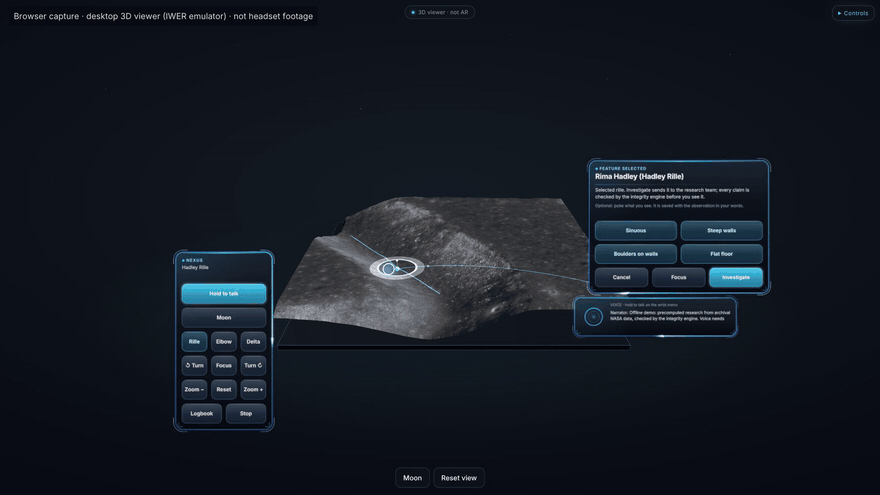</a>

<sub>Browser capture of the desktop 3D viewer (IWER emulator), not headset footage. Click to open the live demo.</sub>

</div>

---

## ✨ What NEXUS does

A scientist places NASA's Moon on a real table, opens a landing site as a 3D terrain model, and **points at a feature**. A team of specialist AI agents researches it using real NASA data. Every claim they make goes through the **Scientific Integrity Engine (SIE)** before it can appear. Findings rise out of the terrain on holographic cards, each one showing its evidence, its uncertainty and the integrity decision. **The scientist decides:** approve, reject, or mark inconclusive.

<table>
<tr>
<td width="33%" valign="top">

### 🖐️ Hands-first
Every action works with hand tracking alone: ray and pinch, fingertip poke, palm-up wrist menu. Voice is only an optional shortcut.

</td>
<td width="33%" valign="top">

### 🛡️ Integrity by design
Agents can only cite evidence that exists in a curated store. Numbers come from deterministic code, not models. Nothing renders without an SIE decision.

</td>
<td width="33%" valign="top">

### 🧑‍🔬 Human in charge
No agent can mark a finding reviewed. AI findings are never shown as "confirmed" or "discovered". The scientist's review is the only final word.

</td>
</tr>
</table>

### 🚀 Try it in 30 seconds

1. Open **[nexus-91f.pages.dev](https://nexus-91f.pages.dev)** in Quest Browser, or any desktop browser.
2. Choose **Enter AR Exploration** on a headset, or **Explore in 3D** on desktop (your mouse is your right hand; a click is a pinch).
3. Pinch the marker on the Moon, select a glowing ring on the terrain, and poke **Investigate**.

The public demo runs fully **offline**: it replays research that was precomputed from archival NASA data and passed through the real SIE, and it says so on every card. No accounts, keys or backend needed.

---

## 📸 A tour of the experience

<table>
<tr>
<td width="50%">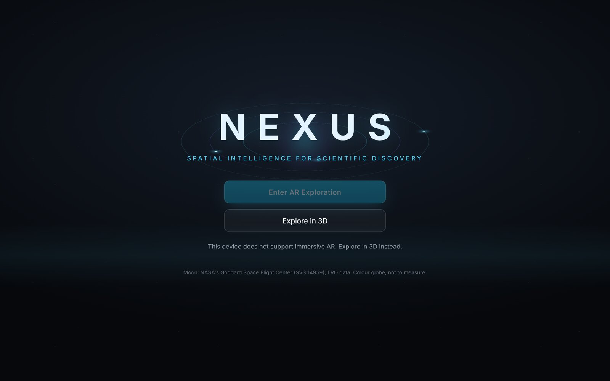<br><b>1. Launch.</b> AR on Quest or an ARCore phone, or the desktop 3D viewer, stated plainly.</td>
<td width="50%">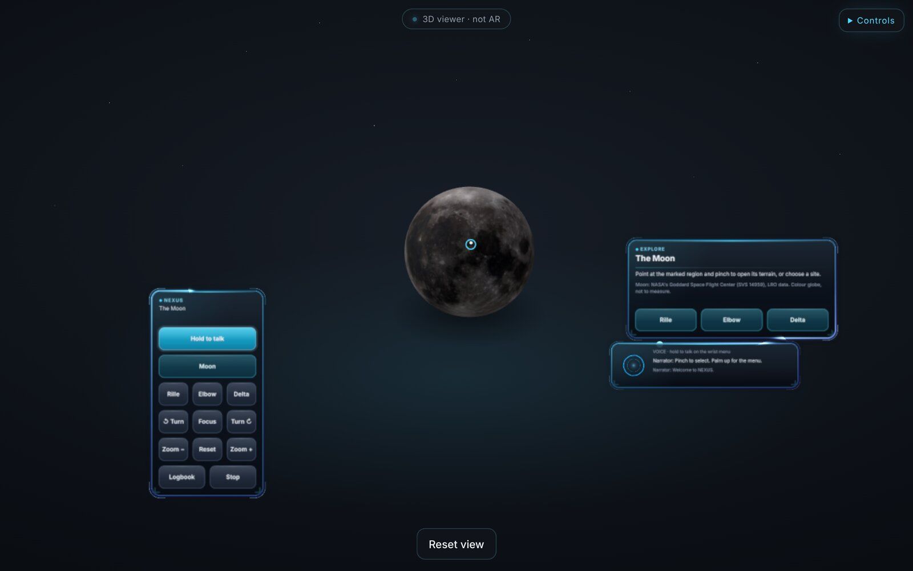<br><b>2. The Moon.</b> NASA's LRO colour globe, with the surveyed Apollo 15 region marked from the evidence itself.</td>
</tr>
<tr>
<td>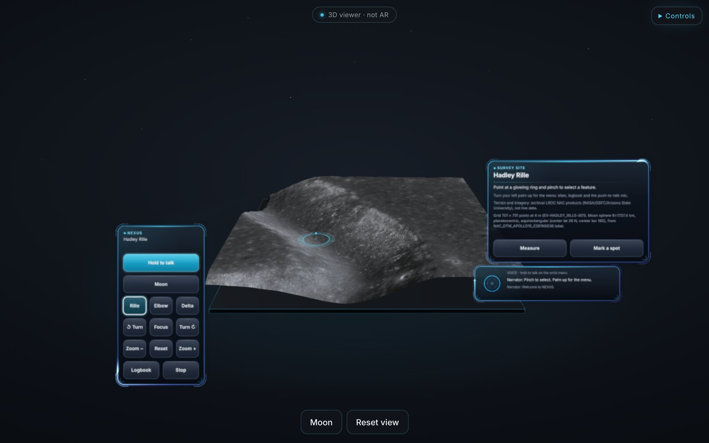<br><b>3. The site.</b> Hadley Rille as a tabletop model built from an LROC NAC elevation model, with level-of-detail tiles tuned for Quest.</td>
<td>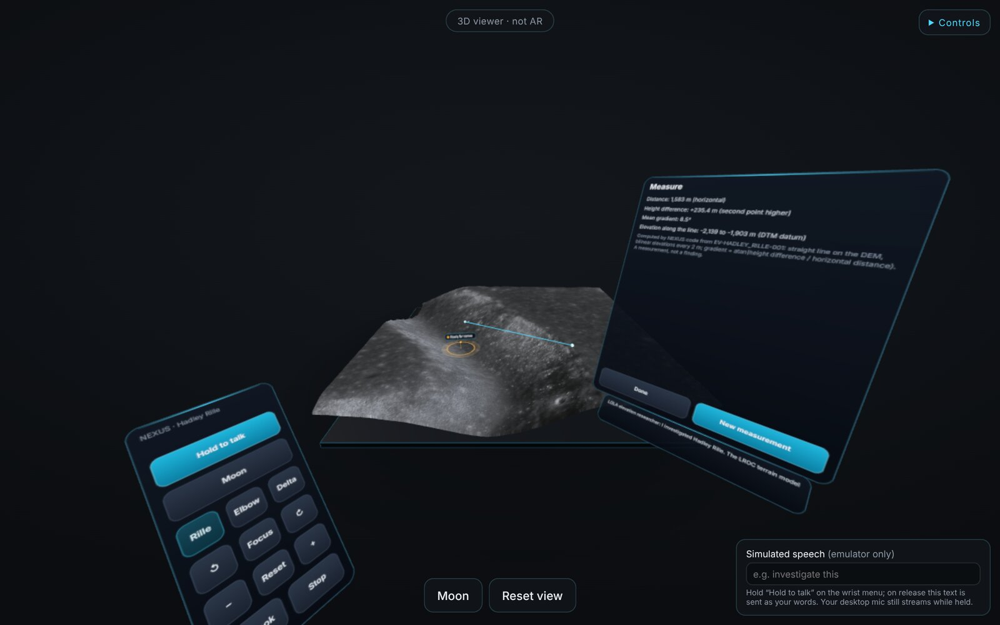<br><b>4. Measure.</b> Two pinches give distance, height difference and gradient, computed by code from the full DEM.</td>
</tr>
<tr>
<td>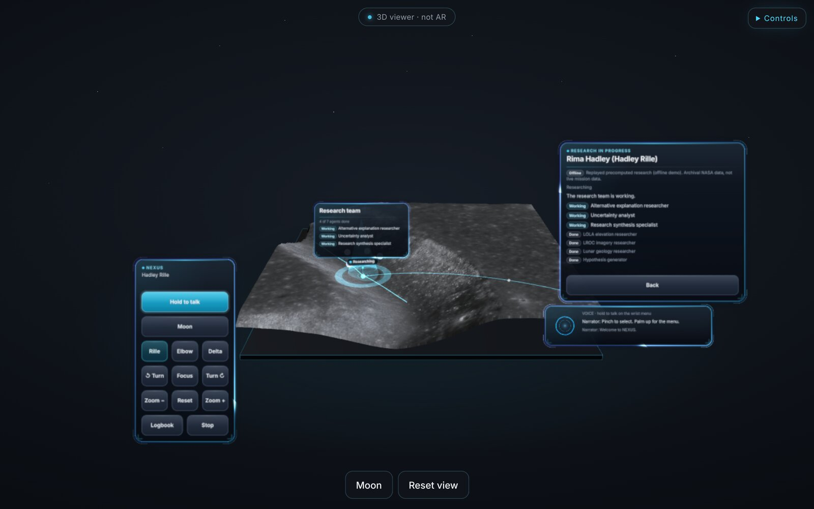<br><b>5. Investigate.</b> The routed research team works on the feature while a scanning beam shows activity, never a result.</td>
<td>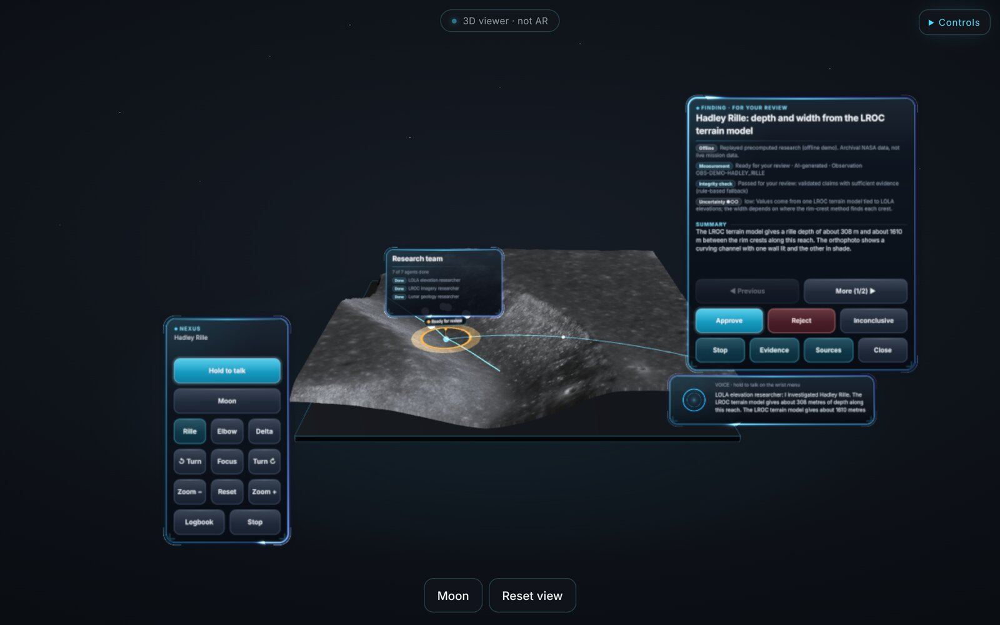<br><b>6. Finding for review.</b> Claim type, uncertainty, integrity decision and the archival-data label, tethered to the feature.</td>
</tr>
<tr>
<td>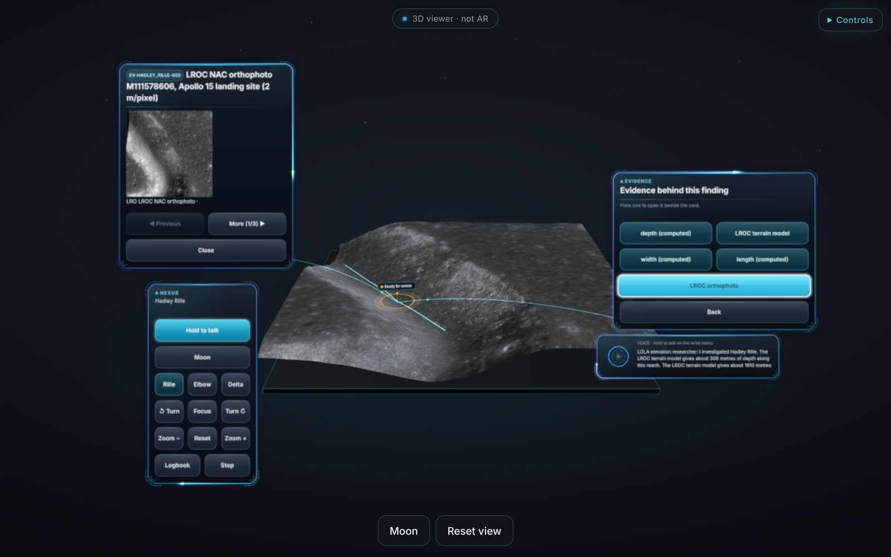<br><b>7. Evidence.</b> Every chip opens a real source, such as an LROC orthophoto, with its credit and licence.</td>
<td>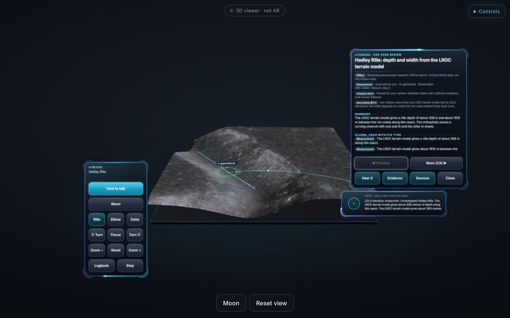<br><b>8. The scientist decides.</b> Approve, reject or inconclusive. Only a human review can close a finding.</td>
</tr>
</table>

<p align="center">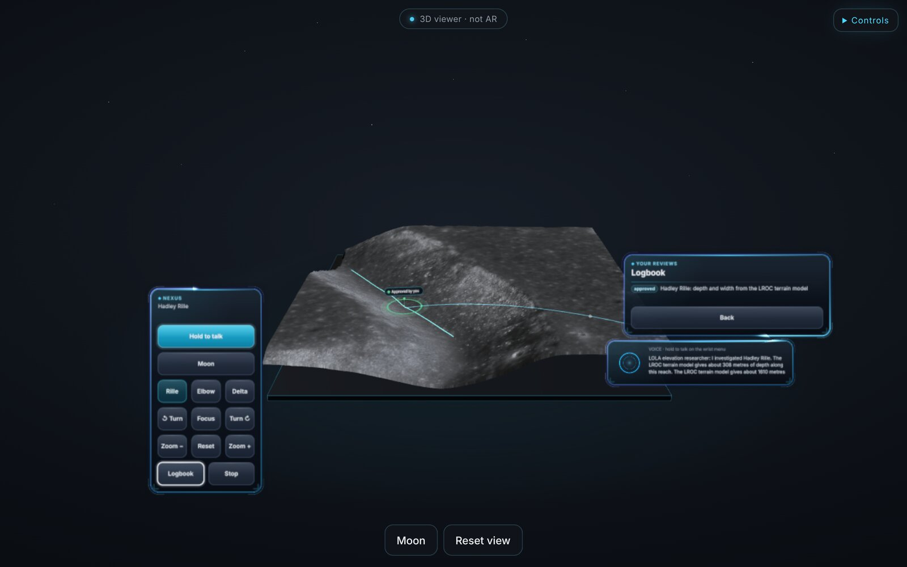<br><b>9. Logbook.</b> Every reviewed finding, with its decision and rationale.</p>

---

## 🧭 How a finding is made

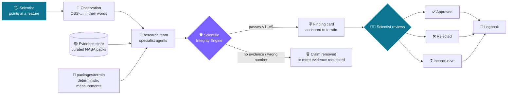

### 🛡️ The Scientific Integrity Engine

Every agent output is checked by pure, unit-tested validators before anything is shown. A planted-bad-claim red-team suite (`pnpm sie:redteam`) runs in CI and must catch every fixture.

| Check | What it enforces |
| --- | --- |
| **V1** Schema | Output parses as `AgentOutput`, or the agent is retried once |
| **V2** Evidence exists | Every cited evidence ID is in the store, or the claim is removed |
| **V3** Numbers match | Every number matches a computed measurement within ±5 % |
| **V4** Scope | Agents stay within their declared field |
| **V5** Claim type | Hypotheses and interpretations never use definite wording |
| **V6** Contradiction | Contradicting evidence forces both sides to be shown |
| **V7** Sufficiency | At least two evidenced claims, including an observation or measurement |
| **V8** Coordinates | No precise coordinate without a CRS and localisation metadata |
| **V9** Self-approval | No agent can set a finding to `reviewed` |
| **VV1–VV3** Voice | Spoken scripts match the claim type, the numbers and the evidence |

Each card shows its claim badges in colour and in words: **observation**, **measurement**, **interpretation** and **hypothesis**, plus a three-step uncertainty meter.

---

## 🏗️ Architecture

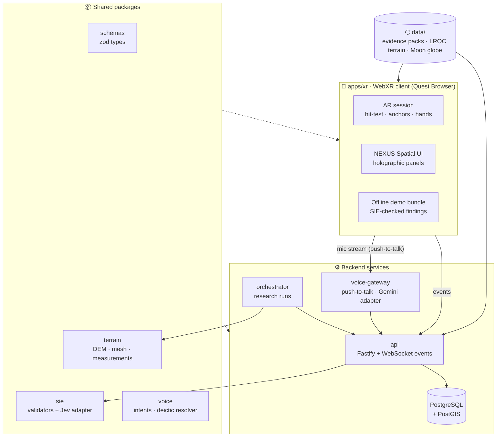

Provider keys never reach the headset: every model, speech and data call goes through a backend adapter. The judged static build needs none of the services above, so it keeps working if any provider is down.

---

## ✅ What's built, and what's next

We only claim what runs. Here is the honest status as of submission.

| Area | Status |
| --- | --- |
| AR placement on a real surface (hit-test, anchors, hand tracking) | ✅ Built, tested in the IWER emulator |
| NASA Moon globe → three Apollo 15 sites (Hadley Rille, Elbow Crater, Hadley Delta) | ✅ Built |
| LROC terrain with level-of-detail tiles inside the Quest vertex budget | ✅ Built |
| Ruler, spot observations and Focus tools | ✅ Built |
| Feature selection, descriptor chips, research run with agent activity | ✅ Built |
| Scientific Integrity Engine (V1–V9, VV1–VV3) and red-team suite in CI | ✅ Built |
| Finding cards, evidence windows, Compare readings, review, logbook | ✅ Built |
| Holographic spatial UI design system | ✅ Built |
| Offline judging build with SIE-checked replayed research | ✅ Live at [nexus-91f.pages.dev](https://nexus-91f.pages.dev) |
| Push-to-talk, intent grammar, deictic resolver ("this ridge") | ✅ Built; speech input is typed as simulated speech until an STT provider is chosen |
| Gemini reasoning adapter and Jev decision adapter | ✅ Merged; the public demo uses the rule-based fallback and replayed findings |
| Cloudflare-hosted backend for live research | 🚧 In progress |
| Live speech recognition | 🔜 Planned |
| Spatial agent voices (HRTF) | 🔜 Planned |
| Evidence Debate between competing hypotheses | 🔜 Planned |
| Verified on a physical Quest headset | 🔜 Planned |

---

## 🛠️ Run it locally

```bash
pnpm install
pnpm dev:xr                 # API (in memory) + orchestrator (precomputed) + voice gateway (simulated speech) + XR client
```

Open https://localhost:5173, accept the self-signed certificate and choose **Explore in 3D**. Pair with code `1234`. Full controls and the hands-only flow are in [`apps/xr/README.md`](apps/xr/README.md).

<details>
<summary><b>More commands</b></summary>

```bash
pnpm dev                    # all services + XR client over HTTPS, for a Quest on the same network
pnpm build:xr:standalone    # the static offline judging build in apps/xr/dist
pnpm deploy:cloudflare      # build and upload it to Cloudflare Pages
docker compose -f infra/docker-compose.yml up -d   # Postgres + PostGIS and services

pnpm typecheck && pnpm lint && pnpm test && pnpm sie:redteam
pnpm test:e2e               # Playwright drives IWER's emulated hands: no app handlers called
```

</details>

---

## 📁 Repository

| Path | What it is |
| --- | --- |
| [`apps/xr`](apps/xr) | WebXR client (Three.js), AR placement, NEXUS Spatial UI |
| [`services/api`](services/api) | Observations, findings, reviews, WebSocket events |
| [`services/voice-gateway`](services/voice-gateway) | Push-to-talk audio in, intent routing, reasoning adapter |
| [`services/orchestrator`](services/orchestrator) | Research runs, precomputed demo bundle |
| [`packages/sie`](packages/sie) | Scientific Integrity Engine |
| [`packages/voice`](packages/voice) | Intent grammar, deictic resolver, system phrases |
| [`packages/terrain`](packages/terrain) | DEM loading, meshes, deterministic measurements |
| [`packages/schemas`](packages/schemas) | zod schemas shared by everything |
| [`agents/`](agents) | Agent team definition and specialist specs |
| [`data/`](data) | Evidence packs, LROC terrain, Moon globe (git LFS) |
| [`docs/`](docs) | Specs, starting with [`PRD.md`](docs/PRD.md) |

<details>
<summary><b>📚 All docs</b></summary>

- [Product requirements](docs/PRD.md) · [Architecture](docs/ARCHITECTURE.md)
- [Scientific Integrity Engine](docs/SCIENTIFIC_INTEGRITY.md) · [Voice Intelligence](docs/VOICE.md)
- [Agent catalog](docs/AGENT_CATALOG.md) · [Interaction (hands + voice)](docs/INTERACTION.md)
- [Data models](docs/DATA_MODELS.md) · [Events](docs/EVENTS.md) · [Datasets](docs/DATASETS.md)
- [Security & privacy](docs/SECURITY_PRIVACY.md) · [Testing](docs/TESTING.md)
- [Task plan](docs/TASKS.md) · [Submission kit](docs/SUBMISSION.md)

</details>

---

## 🏆 About the competition entry

NEXUS is an entry in the **Meta VR Start Developer Competition 2026**, Productivity track. It shows how a mixed-reality workspace can make AI-assisted research faster without letting AI overstate what it knows.

## 🌍 Data credits

Lunar imagery and elevation data courtesy of NASA / GSFC / Arizona State University (LROC) and NASA / GSFC (LOLA), via the Planetary Data System. Moon globe: NASA's Goddard Space Flight Center Scientific Visualization Studio (SVS 14959), LRO data. Simulated or archival data is always labelled in the app and is never presented as live mission data.

## 📄 License

TBD.
