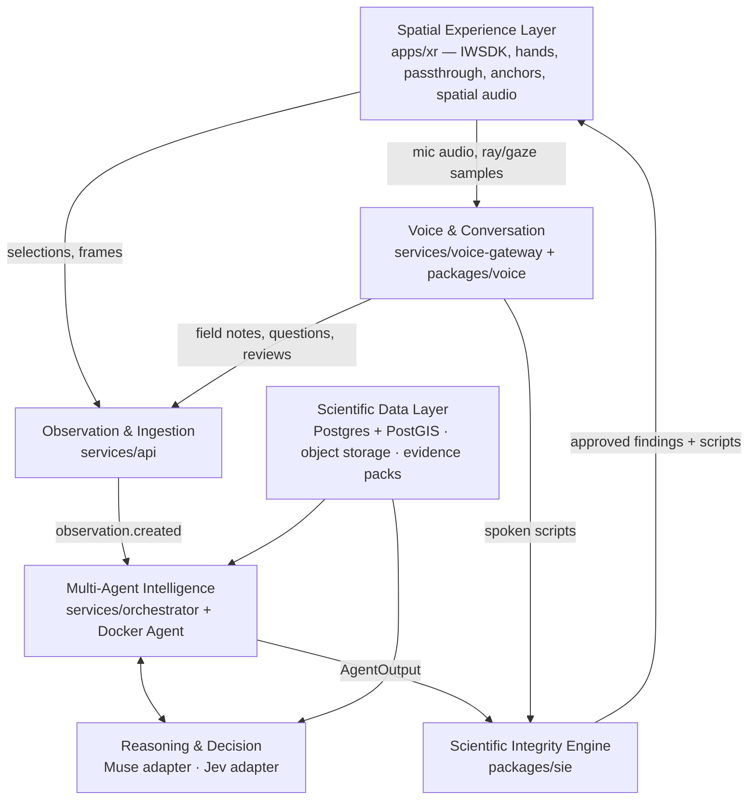

# Architecture

NEXUS has seven layers. Inputs flow down from the headset; the **only** way back up to the scientist — on screen or in their ears — runs through the Scientific Integrity Engine.

## Services

| Service | Port (dev) | Responsibility |
| --- | --- | --- |
| `apps/xr` | 5173 (HTTPS) | Render scene, hand input, passthrough, anchors, play spatial audio, captions, send ray/gaze samples with timestamps |
| `services/api` | 4000 | REST + WebSocket hub. Owns observations, findings, reviews, logbook. Emits all domain events |
| `services/voice-gateway` | 4100 | WebSocket audio in → streaming STT → intent router → actions/questions; TTS out (scripts must carry an SIE decision) |
| `services/orchestrator` | 4200 | Starts Docker Agent team runs per observation, enforces timeouts, parses `AgentOutput`, forwards to SIE |
| Postgres + PostGIS | 5432 | Authoritative records, spatial anchors, audit log |
| Object storage | 9000 | Frames, opt-in audio clips, pre-generated TTS |

## Request flow: spoken field note → finding

1. User holds push-to-talk, points at a crater rim, says "Boulder field here, blocks look angular."
2. XR streams audio + timestamped ray/gaze samples to `voice-gateway`.
3. STT returns words with timestamps. Deictic resolver matches "here" (t=0.84 s) to the ray hit at that time → feature `ELBOW_RIM_E` (confidence 0.91).
4. Intent router → `field_note`. Field Note Interpreter extracts descriptors (`boulder field`, `angular`).
5. `api` creates `Observation` + `FieldNote`; emits `observation.created`.
6. `orchestrator` asks Jev to route (which specialists) → starts Docker Agent team run.
7. Specialists call MCP tools (terrain measurements, evidence pack lookup). Each returns `AgentOutput` JSON.
8. Muse synthesises a draft `ScientificFinding` + spoken briefing script.
9. SIE validates finding (evidence, numbers, scope, claim types, contradictions) and the script (Epistemic Voice Policy).
10. `api` stores finding + decisions; emits `finding.review.required`, `speech.script.validated`.
11. XR anchors the card at the feature; `voice-gateway` synthesises speech; XR plays it from the lead agent's orb position with captions.
12. User reviews by poke or voice; `review.rationale.recorded` stores their words verbatim.

## Modes

- **Live mode:** full pipeline as above.
- **Precomputed mode (default for judging):** steps 6–9 replaced by stored, already-validated findings and pre-generated audio for the three demo sites. Q&A still runs live if available, otherwise falls back to suggested-question answers that are precomputed.

## Adapters

All vendor calls sit behind interfaces in each service:

- `ReasoningAdapter` (Muse), `DecisionAdapter` (Jev)
- `SpeechToTextAdapter`, `TextToSpeechAdapter`
- `DatasetAdapter` (Moon Trek, PDS, local evidence packs)

Each adapter ships with a `Fake*Adapter` used in tests and precomputed mode.

## Deployment (competition build)

- XR client: static HTTPS host (e.g. GitHub Pages) — required for WebXR.
- Backend: Docker-based host with HTTPS + WSS. CORS allow-list = the XR origin only.
- Precomputed bundle shipped with the client so the core demo runs even if the backend is unreachable.
