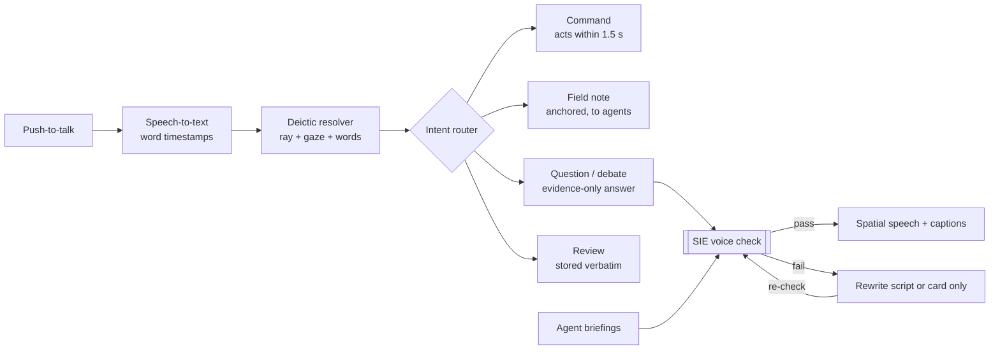

# NEXUS — Product Requirements Document v2 (Voice Intelligence Edition)

Oct 30, 2026 · @yahye mohamed

**Agentic Spatial Intelligence Platform for Scientific Discovery, now with Voice Intelligence**

| Item | Value |
| --- | --- |
| Product | NEXUS |
| Initial environment | Lunar scientific exploration |
| Initial platform | Meta Quest / immersive spatial computing (WebXR via IWSDK) |
| Agent framework | Docker Agent |
| Agent isolation | Docker Sandboxes |
| Decision engine | Jev |
| Reasoning model | Muse (provider integration to be confirmed) |
| Agent communication | Model Context Protocol (MCP) |
| Voice stack (new) | Streaming speech-to-text, grounded dialogue, streaming text-to-speech, spatial audio |
| Competition | Meta VR Start Developer Competition 2026 — Productivity track |
| Document status | Product and technical implementation specification, v2 |

**What's new in v2**

- **Voice Intelligence layer:** scientists talk to NEXUS the way a field geologist talks to a mission team, and NEXUS answers through grounded, spatially placed speech.
- **Spoken Field Notes:** a narrated observation becomes a registered, anchored observation.
- **Deictic grounding:** "this", "that ridge", "the boulder on the left" are resolved from hand ray + gaze + speech together.
- **Spatial agent voices:** each agent speaks from where it is working in the scene.
- **Epistemic Voice Policy:** the Scientific Integrity Engine now also governs *how certain NEXUS sounds*.
- **Evidence Debate mode:** competing hypotheses argue out loud, and the scientist moderates.
- **Hands-complete guarantee:** every voice action has a hand equivalent, as the competition requires.

## 1. Executive Summary

NEXUS is an AI-powered spatial intelligence platform that changes how scientists explore, investigate and understand the physical world. It combines autonomous multi-agent research, scientific datasets, structured decision-making, evidence validation, immersive spatial computing and now **conversational voice intelligence**.

Scientists explore an environment through an immersive headset. When they find an interesting object, structure, formation or anomaly, they can point at it and simply *say what they see*. NEXUS turns that spoken observation into a registered, anchored observation and sends specialised AI research agents to investigate it.

The agents retrieve relevant scientific datasets, analyse observations, investigate historical records, compare possible explanations and assemble evidence. They report back through anchored annotations and spatial voice: each agent's voice comes from the place it is investigating.

A dedicated Scientific Integrity Engine (SIE), powered by Jev and deterministic validators, enforces evidence requirements, agent boundaries, decision policies and uncertainty rules. In v2 it also governs **what NEXUS is allowed to say out loud and how confidently it may say it**.

The scientist remains the final authority, and can approve, reject or challenge a finding by voice or by hand.

NEXUS is not an AI assistant inside VR. It is a scientific investigation platform that connects physical observations, spoken reasoning and autonomous research into evidence-backed spatial intelligence.

### 1.1 Product Vision

A universal scientific intelligence platform where humans and autonomous research agents investigate the physical world together, as naturally as talking to a field team. The Moon is the first environment, not the limit of the platform.

### 1.2 Product Mission

Enable scientists to investigate complex environments with AI research agents that continuously connect what they see and say to relevant scientific knowledge, datasets and evidence.

### 1.3 Core Product Promise

**Explore the world. Say what you see. Let AI investigate. See — and hear — the evidence where it matters.**

## 2. Product Philosophy

NEXUS is built around eight principles: the original five and three new ones for voice.

1. **Evidence before conclusions:** AI-generated scientific claims must be traceable to supporting evidence.
2. **Human scientific authority:** AI investigates and recommends; scientists evaluate and approve.
3. **Spatial intelligence:** information appears in the context of the physical object or location being investigated.
4. **Domain independence:** the core architecture must not depend on lunar-specific assumptions.
5. **Controlled autonomy:** agents operate within explicitly defined permissions, responsibilities and decision boundaries.
6. **Speak at the confidence of the evidence (new):** NEXUS never *sounds* more certain than its evidence allows. A hypothesis is spoken as a hypothesis.
7. **Voice augments, hands complete (new):** every action can be done with hands alone; voice makes it faster, more natural and more accessible.
8. **Conversation is a scientific record (new):** what the scientist says (observations, objections, review rationale) is transcribed, timestamped, anchored and kept in the investigation history, with the scientist's consent.

NEXUS must be able to acknowledge uncertainty, say "I don't have evidence for that", and refuse to produce unsupported conclusions, in text and in speech.

## 3. Initial Product Scope

The first implementation focuses only on lunar scientific exploration, which demonstrates the complete NEXUS investigation workflow, now including voice.

### 3.1 Initial use cases

- Investigating lunar geological formations.
- Inspecting unusual rocks and surface features.
- Comparing observations with orbital imagery.
- Retrieving relevant lunar datasets.
- Examining terrain and elevation information.
- Investigating possible impact structures.
- Comparing observations with historical scientific records.
- Producing evidence-backed research hypotheses.
- Displaying scientific findings in an immersive environment.
- **Narrating spoken field notes that become anchored observations (new).**
- **Questioning, challenging and reviewing findings by voice (new).**
- **Receiving a spoken end-of-session mission briefing (new).**

### 3.2 Future environments

The architecture must support future scientific domains: ocean and underwater exploration, archaeological discovery, volcanic and geological research, deep-earth exploration, environmental and biodiversity research, and planetary exploration including Mars. These are future extensions, not MVP deliverables.

### 3.3 Competition alignment

NEXUS is entered in the Meta VR Start Developer Competition 2026 (deadline Nov 18, 2026, 12:00 PM PST). The product design meets each rule directly.

| Competition requirement | How NEXUS meets it |
| --- | --- |
| Fully completable with hands alone | Every voice action has a hand equivalent (section 6.9); tested with the mic disabled |
| Seated, stationary use | Lunar terrain can be shown as a tabletop model in passthrough or as an immersive scene around a seated user |
| Satisfying in about 10 minutes | A guided investigation of one site, start to approved finding, fits in one session |
| Quick start, easy pause and resume | Palm-up menu or "Pause"; investigation state is saved continuously |
| Original, not a thin wrapper | Own agent orchestration, integrity engine, spatial voice and interaction design |
| Judged on hand tracking, passthrough, spatial anchoring | Pinch and ray selection, passthrough tabletop mode, findings anchored to terrain |

**Track:** Productivity. **Special awards targeted:** Agentic Interaction, Boldest Original Concept, Accessibility Forward, First Five Minutes.

## 4. Target Users

Planetary scientists and geologists are the primary users. Voice matters most to users whose hands, eyes or language make menus slow.

| User | What they do in NEXUS | Why voice helps them |
| --- | --- | --- |
| **Planetary scientists** (primary) | Investigate lunar surface features, examine orbital datasets, compare observations, explore interpretations | Narrate observations as they would in the field; ask follow-ups without leaving the scene |
| **Geologists** (primary) | Investigate formations, compare terrain, examine mineralogical and geological explanations | Describe textures and structures faster than typing; argue with hypotheses out loud |
| **Research institutions** (primary) | Collaborate, share observations, review AI research, keep traceable records | Spoken review rationale becomes part of the audit trail |
| Astronauts and future lunar mission teams | Rehearse traverses, review sites | Gloved or busy hands; voice is the natural channel in suits |
| Space exploration researchers and university groups | Teaching, method review | Spoken briefings and captions support classrooms |
| Scientific data organisations | Dataset discovery and provenance | Ask "where did this come from?" and hear the source |
| **Users with limited hand mobility or low vision (new)** | Full investigations | Voice navigation, read-aloud cards and captions |
| **Non-English-speaking researchers (new)** | Full investigations | Multilingual speech in and out (section 6.8) |

## 5. Core User Experience

### 5.1 The NEXUS lunar environment

The user enters the lunar environment on Meta Quest in one of two modes:

- **Immersive mode:** the user is surrounded by 3D lunar terrain.
- **Tabletop mode (passthrough):** a real-scale-referenced terrain model sits on the user's real desk, so they stay seated in their own room.

The environment contains 3D lunar terrain, geographic references, observation markers, orbital imagery overlays, research annotations, observation and video panels, interactive evidence windows, and **agent presence orbs** that show where each agent is working and from where its voice comes.

Interaction is natural hand tracking (pinch, ray, poke, grab, palm-up menu), with voice as a parallel channel.

### 5.2 Scientific investigation workflow

Example: a scientist finds an unusual lunar rock formation.

1. The scientist points at the formation and says, "Unusual layered outcrop here, darker band near the top." (Or pinches it.)
2. NEXUS resolves "here" to the pointed location (deictic grounding) and records a **Spoken Field Note**.
3. The observation receives a unique identifier and stores spatial coordinates, image reference, transcript, audio reference and metadata.
4. The Research Coordinator receives it; keywords in the note ("layered", "darker band") help select specialists.
5. Relevant specialist agents are activated and their orbs fly to the site.
6. Agents investigate using available scientific datasets.
7. Muse synthesises research and possible interpretations.
8. Jev evaluates structured decision questions.
9. Deterministic validators check evidence references, data structures and policy requirements.
10. The SIE decides whether more investigation is needed, and approves the *spoken script* as well as the written finding.
11. A structured scientific finding is produced and attached to the spatial location.
12. The lead agent briefs the scientist in spatial voice from the site: "One possibility, with medium uncertainty, is…"
13. The scientist opens the annotation and examines the evidence.
14. The scientist asks follow-ups, starts an Evidence Debate, requests more research, or approves, rejects or marks the finding inconclusive, with a spoken or poked reason that is recorded.

### 5.3 Spatial scientific annotations

When a finding is ready, the object receives a visual highlight and a soft spatial audio cue from its location, so the scientist can *hear* where to look.

Selecting the object opens a spatial research window containing: observation ID, research summary, possible interpretations, supporting and contradicting evidence, referenced datasets, source information, uncertainty explanation, research status, follow-up options, the original Spoken Field Note transcript, and a play button for it.

**Evidence beams:** when a claim is selected or spoken, a thin line links the card to the exact terrain point or image region that the evidence refers to.

The highlight must never visually or audibly imply that an unverified hypothesis is a confirmed discovery.

| State | Visual | Audio cue |
| --- | --- | --- |
| Observation recorded | Thin grey ring | Soft click |
| Research in progress | Pulsing ring + agent orbs | Low ambient hum from the site |
| Finding ready for review | Steady amber ring | Two-note chime from the site |
| Scientist-reviewed finding | Solid green ring | Resolved chord |
| Rejected or inconclusive | Grey ring with cross or question mark | Muted tone |

## 6. NEXUS Voice Intelligence (new)

Voice turns NEXUS from a tool the scientist operates into a field team the scientist talks to, but every spoken word NEXUS produces passes the same integrity gate as its written findings.

### 6.1 Design goals

- Talk like a field geologist: describe, point, question, decide.
- Hear findings from where they are, not from a floating speaker.
- Never let voice become a shortcut around evidence.
- Never require voice: the experience must stay hands-complete.
- Fast: a command acts within 1.5 s; an answer starts within 4 s.

### 6.2 Spoken Field Notes

The scientist narrates what they see while pointing. Each note becomes a structured observation: transcript, audio clip, pointed location, view direction, timestamp and extracted descriptors (colour, texture, shape, size words). The note is the start of an investigation, not a chat message.

Example: "Boulder field on the east rim, some blocks look angular." → observation `OBS-0142`, descriptors `{boulder field, angular, east rim}`, anchored to the rim point under the hand ray.

### 6.3 Deictic grounding ("this", "that", "here")

NEXUS combines three signals to decide what the scientist means:

1. **Hand ray** target at the moment the word "this" or "that" is spoken (word timestamps from speech-to-text).
2. **Head direction** as a tie-breaker.
3. **Spoken qualifiers** ("the darker one", "on the left", "the bigger crater") matched against nearby labelled features.

If confidence is low, NEXUS asks once: "Do you mean the crater rim or the boulder below it?" and highlights both candidates. It never guesses silently.

### 6.4 Spatial agent voices

Each agent group has a distinct, calm voice, and that voice is placed in 3D at the agent's orb using HRTF spatial audio (Web Audio `PannerNode`). The Terrain agent speaks from the crater floor; the Orbital Imagery agent from above the site; the Skeptic from beside the scientist. Spatial sound tells the scientist *who* is speaking and *where* the evidence is without reading anything.

A single **Narrator** voice handles system messages (onboarding, errors, briefings) and always speaks from a fixed, comfortable position.

### 6.5 Epistemic Voice Policy

This is the most important voice innovation: the SIE controls how certain NEXUS sounds.

| Claim type | Allowed spoken framing | Forbidden |
| --- | --- | --- |
| Direct observation | "The image shows…", "I can see…" | Interpretive words ("caused by") |
| Dataset measurement | "LOLA elevation data gives about 120 m…" (with source) | Numbers not in the measurement record |
| Interpretation | "This is consistent with…", "One interpretation is…" | "This is…", "This proves…" |
| Hypothesis | "One possibility, with high uncertainty, is…" | Any definite phrasing |
| Unverified speculation | Not spoken unless the scientist asks for speculation, then prefixed "Speculating, without evidence…" | Default speech |

Every spoken script is checked by a deterministic phrase validator before text-to-speech. Uncertainty level also shapes delivery: higher uncertainty means slower pace and an explicit uncertainty statement, not just softer wording.

### 6.6 Evidence Debate mode

The scientist says "Debate this" (or pokes Debate). Two agents, the Hypothesis Advocate and the Alternative Explanation Researcher, each present their strongest evidence-backed case in turn, speaking from opposite sides of the site. Each turn must cite evidence IDs; the SIE removes uncited turns. The scientist can interrupt ("Stop. Address the rim shape."), ask either side a question, and end with a verdict. The debate transcript is attached to the finding.

### 6.7 Conversational research

- **Follow-ups:** "Why this interpretation?", "What contradicts it?", "Which datasets support it?", "What observation would tell these apart?", "Compare with Elbow crater."
- **Provenance on demand:** "Where does that come from?" → NEXUS names the dataset, product ID and date, and draws an evidence beam to the exact source region.
- **Barge-in:** the scientist can speak while NEXUS is talking; speech stops at once and the new request takes over.
- **Spoken review rationale:** "Reject: the rim is too degraded for that age" is transcribed and stored with the decision.
- **Mission briefing:** at the end of a session, NEXUS gives a 60-second spoken summary of what was observed, what was approved and what remains open, plus a written version in the Logbook.

### 6.8 Multilingual and accessibility

- Speech in and out in several languages from launch (target: English, Arabic, Somali, French, Spanish, subject to verified speech-to-text and text-to-speech quality per language). Scientific terms and dataset names stay in their original form.
- Live captions for everything spoken in either direction.
- Read-aloud for every card and panel.
- Whisper mode: text-only output for shared or quiet spaces.
- Adjustable speech rate and voice volume per agent group.

### 6.9 Voice and hands parity

| Action | Hands (always available) | Voice (optional) |
| --- | --- | --- |
| Record observation | Pinch the feature, then poke a descriptor chip | Point and describe it |
| Start investigation | Poke Investigate | "Investigate this" |
| Navigate terrain | Pinch-drag, two-hand zoom | "Zoom in", "Go to Hadley Rille" |
| Ask a question | Poke a suggested question chip | Ask anything |
| Show provenance | Poke a source chip | "Where does that come from?" |
| Start debate | Poke Debate | "Debate this" |
| Review | Poke Approve / Reject / Inconclusive + reason chip | Say the decision and reason |
| Pause / resume | Palm-up menu | "Pause" |

The full investigation is tested end to end with the microphone disabled.

### 6.10 Voice pipeline

Push-to-talk is the default (palm up, pinch and hold the mic; release to send). An optional wake phrase ("NEXUS") can be enabled in settings. Quest Browser does not expose the Web Speech recognition API, so recognition runs server-side over a streaming connection.



Commands and reviews act directly; field notes start research; anything NEXUS will say aloud, whether an answer or an agent briefing, is checked by the SIE and rewritten or shown as a card only if it fails.

## 7. System Architecture

NEXUS has seven layers; v2 adds the Voice and Conversation layer, and the SIE remains the only path from research to the scientist's eyes and ears.

See the architecture diagram in [ARCHITECTURE.md](ARCHITECTURE.md).

Inputs flow down from the headset through voice and ingestion to the agents; the only way back up to the scientist runs through the Integrity Engine.

### 7.1 Spatial Experience Layer

The scientist's immersive environment. **Technology:** Meta Quest, WebXR via IWSDK (or a compatible native Meta XR build), Three.js, hand tracking and gestures, passthrough and spatial anchors, Web Audio spatial sound, WebSocket sync, and a Next.js companion dashboard. **Responsibilities:** render terrain, markers, annotations and agent orbs; handle hand interaction; play spatial voice; synchronise observations and investigation status.

### 7.2 Voice and Conversation Layer (new)

Turns speech into grounded actions and grounded answers into speech. **Components:** microphone capture and push-to-talk, streaming speech-to-text with word timestamps, deictic resolver (ray + gaze + words), intent router (command, field note, question, review, debate), dialogue manager with per-observation context, spoken-script generator, Epistemic Voice validator (inside the SIE), streaming text-to-speech, spatial audio placement, captions. **Rule:** this layer cannot speak anything the SIE has not approved, except fixed system phrases.

### 7.3 Observation and Data Ingestion Layer

Receives and processes observations. **Inputs:** images, prerecorded video, future live video, simulated telemetry (clearly labelled), spatial coordinates, orbital datasets, scientific metadata, **spoken field notes**. **Processing:** ingestion, selected-frame extraction, timestamp sync, metadata validation, observation registration, spatial anchoring, descriptor extraction from speech. AI does not process every video frame; selected frames, user-selected objects and observation events start research. Simulated telemetry and archival imagery are never presented as live mission data.

### 7.4 Multi-Agent Intelligence Layer

Powered by Docker Agent: specialised agent definitions, task coordination, delegation, parallel investigation, MCP tool connections, task status, permissions and multiple model providers. Supports a library of 56 agent configurations with dynamic activation; never all at once.

### 7.5 Reasoning and Decision Layer

**Muse (research reasoning):** investigate observations, interpret literature, compare hypotheses, synthesise findings, explain interpretations, find gaps, recommend next steps, and draft spoken scripts.

**Jev (structured decisions):** evaluate predefined decision questions, prioritise tasks, route observations to specialists, check evidence requirements, decide escalation, apply decision policies, and decide whether a deictic reference needs clarification. Jev is not a scientific truth detector; its decisions rest on validated inputs and explicit policies.

### 7.6 Scientific Integrity Engine

The mandatory control layer between autonomous research and presentation, written *and* spoken. Full rules are in section 10.

### 7.7 Scientific Data Layer

Stores observations, findings, sources, spatial anchors, research history, **transcripts and audio references**, and connects to scientific datasets. **Technology:** PostgreSQL, PostGIS, S3-compatible object storage for media and audio, vector retrieval where appropriate, dataset-specific ingestion adapters.

## 8. The Agent Library (56 configurations)

NEXUS defines 56 specialised agent configurations: the original 50 in six groups plus a new Voice and Conversation group of 6. They are distinct responsibilities, not 56 running processes.

| Group | # | Agents |
| --- | --- | --- |
| 1. Observation Intelligence | 10 | 1 Observation Coordinator · 2 Lunar Image Analyst · 3 Video Frame Analyst · 4 Geological Feature Detector · 5 Rock Formation Analyst · 6 Surface Anomaly Analyst · 7 Terrain Observation Analyst · 8 Visual Comparison Researcher · 9 Observation Metadata Validator · 10 Observation Quality Auditor |
| 2. Scientific Research | 12 | 11 Lunar Geology Researcher · 12 Impact Crater Researcher · 13 Mineralogy Researcher · 14 Lunar Volcanism Researcher · 15 Regolith Researcher · 16 Tectonic Feature Researcher · 17 Surface Evolution Researcher · 18 Planetary Science Literature Researcher · 19 Geological Hypothesis Researcher · 20 Historical Observation Researcher · 21 Scientific Methodology Researcher · 22 Research Synthesis Specialist |
| 3. Dataset Intelligence | 10 | 23 NASA Dataset Discovery Agent · 24 Lunar Reconnaissance Orbiter Researcher · 25 LROC Imagery Researcher · 26 LOLA Elevation Data Researcher · 27 Terrain Model Analyst · 28 Orbital Imagery Comparison Agent · 29 Spatial Metadata Analyst · 30 Dataset Quality Auditor · 31 Scientific Source Retrieval Agent · 32 Dataset Provenance Validator |
| 4. Hypothesis and Evidence Analysis | 8 | 33 Hypothesis Generator · 34 Alternative Explanation Researcher · 35 Evidence Comparison Agent · 36 Contradiction Detection Agent · 37 Scientific Uncertainty Analyst · 38 Research Gap Detector · 39 Follow-up Investigation Planner · 40 Hypothesis Review Agent |
| 5. Scientific Integrity | 6 | 41 Source Verification Agent · 42 Evidence Integrity Auditor · 43 Claim Classification Agent · 44 Scientific Scope Validator · 45 Finding Consistency Auditor · 46 Human Review Escalation Agent |
| 6. Spatial Intelligence | 4 | 47 Spatial Coordinate Validator · 48 Scientific Annotation Generator · 49 Spatial Evidence Anchor Agent · 50 Environment Synchronisation Agent |
| **7. Voice and Conversation (new)** | **6** | 51–56, below |

### 8.1 Group 7: Voice and Conversation agents

| # | Agent | Responsibility | May not |
| --- | --- | --- | --- |
| 51 | Field Note Interpreter | Turns a transcript into a structured observation with descriptors | Add descriptors the scientist didn't say |
| 52 | Deictic Reference Resolver | Combines word timestamps, hand ray and gaze to resolve "this" and "that"; asks when unsure | Pick silently below the confidence threshold |
| 53 | Dialogue Grounding Agent | Answers follow-up questions from the observation's evidence records only | Use knowledge outside the evidence pack without labelling it |
| 54 | Spoken Briefing Composer | Writes short spoken scripts for findings, progress and the mission briefing | Bypass the Epistemic Voice validator |
| 55 | Debate Moderator | Runs Evidence Debate turns, keeps time, enforces citations | Declare a winner |
| 56 | Review Rationale Recorder | Transcribes and attaches the scientist's spoken decision and reason | Change or summarise the scientist's words |

### 8.2 Agent execution policy

- The coordinator activates agents by observation type and by descriptors from the spoken field note.
- Independent tasks run in parallel; dependent tasks wait for required outputs.
- Agents return structured outputs; the SIE validates every one.
- Duplicate tasks are detected and merged; failed tasks retry under bounded policies.
- Agents cannot approve their own findings.
- Voice agents (51–56) run in a low-latency pool and never wait behind research agents.

A simple observation uses 3–5 agents plus the voice agents in use; a complex investigation uses 10–15 or more.

## 9. Docker Agent and Sandboxing

Docker Agent provides agent definitions, hierarchy, model-provider integrations, tools and MCP connectivity; Docker Sandboxes isolate autonomous agent workflows.

**Requirements**

- Reusable specialist agent configurations with parent and child delegation.
- A restricted tool set per specialist.
- Isolated execution contexts with CPU and memory limits where supported.
- Execution timeouts and restricted external network access.
- Read-only access to source datasets wherever possible.
- No shared credentials between agents.
- Every agent output validated; task logs and execution history kept.

**Voice-specific requirements (new)**

- Voice agents (51–56) run in a **warm pool** of pre-started workers so they meet the 1.5 s command and 4 s answer targets.
- Raw audio never enters research agent sandboxes; research agents receive transcripts and descriptors only.
- Speech-to-text and text-to-speech provider keys live only in the voice gateway service, never in agent sandboxes or the headset client.

**Allocation:** no 50+ permanent sandboxes by default. Use bounded worker execution and dynamic allocation; only the small voice pool stays warm.

Exact Docker Agent YAML, CLI commands, sandbox integration and hierarchy behaviour must be validated against the installed Docker Agent version and official documentation before implementation.

## 10. Scientific Integrity Engine: Decision Boundaries

The SIE evaluates every finding before it appears in the spatial environment, and in v2 every spoken script before it is voiced. It is NEXUS's core differentiator.

### 10.1 Responsibilities

1. Validate agent output schemas.
2. Verify that referenced sources and evidence IDs exist.
3. Enforce agent scope boundaries.
4. Check required evidence conditions.
5. Detect contradictory evidence.
6. Distinguish observations from interpretations and hypotheses.
7. Enforce uncertainty and review policies.
8. Prevent unsupported claims from being presented as established facts.
9. Escalate ambiguous or high-impact findings to scientists.
10. Keep an auditable history of decisions.
11. **Validate every spoken script against the Epistemic Voice Policy (new).**
12. **Confirm deictic references above the confidence threshold before an observation is registered (new).**

The SIE combines Jev with conventional deterministic validation. A decision model cannot guarantee scientific truth; reliability needs provenance, data validation, suitable methods and human review.

### 10.2 Boundaries

| Boundary | Rule |
| --- | --- |
| Evidence | A claim cannot be shown as evidence-backed unless its evidence exists and is accessible |
| Scope | Agents cannot decide outside their assigned responsibilities |
| Data | Agents cannot invent source IDs, datasets, measurements or coordinates |
| Uncertainty | An interpretation cannot automatically become a confirmed discovery |
| Permission | Agents cannot act beyond their assigned permissions |
| Human authority | High-impact conclusions require human review |
| **Voice (new)** | Nothing is spoken that has not passed the SIE; spoken framing must match the claim type; numbers spoken must match measurement records |
| **Reference (new)** | An observation cannot be anchored to a location the system could not resolve with confidence |
| **Attribution (new)** | The scientist's spoken words are stored verbatim and never paraphrased into a claim the scientist did not make |

### 10.3 Decision outcomes

`ACCEPT_FOR_REVIEW` · `REQUEST_MORE_EVIDENCE` · `REJECT` · `ESCALATE_TO_SCIENTIST`, plus for speech `SPEAK_AS_APPROVED` · `REWRITE_SCRIPT` · `SILENT_CARD_ONLY`. These are workflow decisions, not proof that a claim is true.

### 10.4 Claim categories

Every finding distinguishes: direct observation, dataset-supported measurement, scientific interpretation, research hypothesis, unverified speculation. Each category has an allowed spoken framing (section 6.5).

### 10.5 Decision policy inputs

```typescript
interface ScientificDecisionInput {
  observationId: string;
  agentId: string;
  agentScopeValid: boolean;
  evidenceIds: string[];
  sourcesVerified: boolean;
  contradictoryEvidence: boolean;
  claimType: "observation" | "measurement" | "interpretation" | "hypothesis";
  uncertaintyDeclared: boolean;
  // new in v2
  output: "card" | "speech";
  spokenScript?: string;
  spokenNumbersMatchRecords?: boolean;
  framingMatchesClaimType?: boolean;
  deicticConfidence?: number; // 0..1
}

type ScientificDecision =
  | "ACCEPT_FOR_REVIEW"
  | "REQUEST_MORE_EVIDENCE"
  | "REJECT"
  | "ESCALATE_TO_SCIENTIST";

type VoiceDecision = "SPEAK_AS_APPROVED" | "REWRITE_SCRIPT" | "SILENT_CARD_ONLY";
```

The final policy uses validated inputs, explicit rules and Jev's supported decision interface.

## 11. Data Models

Every investigation produces a structured `ScientificFinding`; v2 adds `FieldNote` and `VoiceUtterance` so that speech is a first-class, auditable record.

### 11.1 ScientificFinding

```typescript
interface ScientificFinding {
  id: string;
  observationId: string;
  title: string;
  summary: string;
  claimType: "observation" | "measurement" | "interpretation" | "hypothesis";
  possibleInterpretations: {
    explanation: string;
    supportingEvidenceIds: string[];
    contradictingEvidenceIds: string[];
  }[];
  sources: { dataset: string; sourceUrl: string; evidenceId: string; observationId?: string }[];
  spatialAnchor: {
    latitude?: number;
    longitude?: number;
    altitude?: number;
    coordinateReferenceSystem?: string;
    terrainFeatureId?: string;
  };
  uncertainty: { level: "low" | "medium" | "high"; explanation: string };
  decision: {
    outcome: "ACCEPT_FOR_REVIEW" | "REQUEST_MORE_EVIDENCE" | "REJECT" | "ESCALATE_TO_SCIENTIST";
    reason: string;
  };
  status: "researching" | "ready_for_review" | "reviewed" | "rejected" | "inconclusive";
  // new in v2
  spokenBriefing?: { script: string; voiceDecision: "SPEAK_AS_APPROVED" | "REWRITE_SCRIPT" | "SILENT_CARD_ONLY"; audioRef?: string };
  debateTranscriptId?: string;
  review?: { decision: "approved" | "rejected" | "inconclusive"; rationaleUtteranceId?: string; reviewerId: string };
  createdAt: string;
  updatedAt: string;
}
```

### 11.2 FieldNote (new)

```typescript
interface FieldNote {
  id: string;
  observationId: string;
  utteranceId: string;            // the spoken source
  transcript: string;             // verbatim
  language: string;               // BCP-47, e.g. "so", "en"
  descriptors: string[];          // only words the scientist used
  reference: {
    method: "ray" | "ray+gaze" | "ray+gaze+qualifier" | "manual";
    confidence: number;           // 0..1
    clarificationAsked: boolean;
    targetFeatureId?: string;
  };
  spatialAnchor: ScientificFinding["spatialAnchor"];
  createdAt: string;
}
```

### 11.3 VoiceUtterance (new)

```typescript
interface VoiceUtterance {
  id: string;
  sessionId: string;
  speaker: "scientist" | "narrator" | `agent:${string}`;
  direction: "in" | "out";
  intent?: "command" | "field_note" | "question" | "review" | "debate" | "clarification";
  transcript: string;
  words?: { text: string; startMs: number; endMs: number }[];  // used for deictic timing
  audioRef?: string;              // stored only with consent
  language: string;
  sieDecisionId?: string;         // required for every outbound utterance except fixed system phrases
  createdAt: string;
}
```

All coordinates include the coordinate reference system. A video frame or a spoken "here" never receives a precise lunar coordinate unless there is enough localisation metadata.

## 12. Lunar Scientific Data Integration

NEXUS uses real public scientific data wherever possible, starting with a small preselected set rather than every NASA archive.

| Source | Use in NEXUS |
| --- | --- |
| NASA Moon Trek | Lunar visualisation and map services; base terrain and geographic context |
| Lunar Reconnaissance Orbiter Camera (LROC) | Orbital imagery, high resolution where available |
| Lunar Orbiter Laser Altimeter (LOLA) | Elevation and topography; source of spoken measurements |
| NASA Planetary Data System (PDS) | Dataset discovery, retrieval, metadata and archival research |
| Later: Mini-RF and other LRO instruments | Additional evidence types |

**Initial demo region:** the Apollo 15 Hadley–Apennine area (Hadley Rille and nearby features), chosen because it is well documented and has features with several historical interpretations. Exact sites and products are confirmed in Moon Trek in Phase 1.

**Integration rules**

- Verify source and dataset identifiers; preserve source metadata and acquisition timestamps.
- Check coordinate systems.
- Verify licensing and attribution; show credits on cards and **say the source when asked**.
- Never treat orbital imagery as live astronaut telemetry or simulated measurements as real ones.
- **Spoken names:** each dataset has a short, pronounceable spoken label (e.g. "LOLA elevation data") mapped to its full product ID, so speech stays clear and provenance stays exact.

## 13. Video and Observation Synchronisation

The initial experience uses a prerecorded lunar observation video with a clearly labelled simulated timeline, and now lets the scientist narrate over it.

Each observation event contains: video ID, frame timestamp, observation ID, simulated or verified location, camera metadata where available, frame reference, observation description, and **any field note spoken while the frame was on screen**.

**Voice + video behaviour (new)**

- Saying "Mark this" or "Note: …" during playback pauses on the current frame and creates a field note tied to that frame's timestamp.
- "Go back ten seconds", "Play", "Pause" control playback by voice; hands use the panel scrubber.
- Agent narration ducks (lowers) video audio automatically.

The interface synchronises video playback, selected observations, research progress, spoken notes and spatial annotations. Future live mission integration requires authorised video, telemetry, localisation and mission data interfaces; WebRTC can be used for future real-time video and voice transport.

## 14. NEXUS User Interface

The lunar environment is the workspace; panels stay minimal, and voice reduces how many panels are needed.

### 14.1 Main immersive environment

A premium scientific interface: dark, restrained visual language, realistic terrain, subtle luminous annotations, minimal floating UI, clear hierarchy and smooth hand interaction. Avoid excess holographic panels and decorative AI graphics. Sound design follows the same restraint: soft cues, no beeping.

### 14.2 Panels

| Panel | Shows |
| --- | --- |
| Observation | Current observation, video frame, timestamp, location metadata, description, research status, **field note transcript + play** |
| Scientific research | Active agents, progress, sources being investigated, findings returned, missing evidence, status |
| Spatial finding | Claim, category, interpretations, supporting and contradicting evidence, sources, uncertainty, SIE decision, review controls, **Debate and Read-aloud buttons** |
| Logbook (new) | All observations, decisions and spoken rationales for the session; mission briefing |

### 14.3 Voice UI (new)

- **Mic state on the wrist:** idle (outline), listening (filled, live waveform), thinking (slow pulse), speaking (the speaking agent's orb glows).
- **Live caption strip** below the active card: scientist's words in one colour, NEXUS in another, agent name before each line.
- **Transcript peek:** while the mic is held, the words appear as they are recognised so the scientist can see mistakes early.
- **Clarification chips:** when a reference is ambiguous, candidate features glow and appear as chips to poke or name.
- **Speaking orb:** the agent currently speaking glows and its evidence beam pulses with its speech.

### 14.4 Research conversation

Scientists can ask by voice or with suggested chips: "Why this interpretation?", "What evidence contradicts it?", "Which datasets support it?", "What observation would distinguish these?", "Compare with another observation." Answers stay grounded in the observation and evidence records, and every answer is shown as text and spoken (unless Whisper mode is on).

## 15. Backend and Infrastructure

The original stack stays; v2 adds a Voice Gateway service and spatial audio in the client.

| Component | Technology |
| --- | --- |
| Immersive experience | WebXR / IWSDK / Three.js |
| Frontend | TypeScript |
| Companion dashboard | Next.js |
| Backend | Node.js / Fastify |
| Database | PostgreSQL |
| Spatial database | PostGIS |
| Agent framework | Docker Agent |
| Execution isolation | Docker Sandboxes |
| Agent communication | MCP |
| Reasoning | Muse |
| Decision model | Jev |
| Realtime events | WebSocket |
| **Voice gateway (new)** | Node.js service; streams mic audio in and speech audio out over WebSocket |
| **Speech-to-text (new)** | Hosted streaming STT with word timestamps and multilingual support (provider chosen in Phase 1 by latency and language tests) |
| **Text-to-speech (new)** | Hosted streaming TTS with several distinct voices; scripted lines pre-generated and cached |
| **Spatial audio (new)** | Web Audio API, HRTF `PannerNode` per agent orb |
| **Native fallback (optional)** | Unity build with Meta Voice SDK if the web path can't meet latency targets |
| Video streaming, future | WebRTC |
| Object storage | S3-compatible (media, audio clips) |
| Deployment | Docker-based infrastructure |

Adapters for model, speech and data providers keep NEXUS independent of any single vendor.

## 16. API and Event Architecture

Communication is event-driven; the backend owns the authoritative observation and finding records, and agents write only through validated service interfaces.

| Area | Events |
| --- | --- |
| Observation | `observation.created` · `observation.selected` |
| Research | `research.started` · `agent.task.dispatched` · `agent.task.completed` · `agent.task.failed` · `evidence.retrieved` |
| Findings | `finding.generated` · `finding.validation.completed` · `finding.review.required` · `finding.approved` · `finding.rejected` |
| Spatial | `spatial.annotation.created` |
| **Voice in (new)** | `voice.capture.started` · `voice.transcript.partial` · `voice.transcript.final` · `voice.intent.resolved` · `voice.reference.resolved` · `voice.reference.clarification_required` · `fieldnote.created` |
| **Voice out (new)** | `speech.script.generated` · `speech.script.validated` · `speech.script.rewritten` · `speech.playback.started` · `speech.playback.interrupted` · `speech.playback.completed` |
| **Conversation (new)** | `debate.started` · `debate.turn.completed` · `debate.ended` · `review.rationale.recorded` · `briefing.generated` |

**Ordering rule:** `speech.playback.started` can only follow `speech.script.validated` for the same script ID; the gateway refuses to play anything else.

## 17. Security, Privacy and Reliability

The original controls stay, and voice adds privacy rules because a microphone in a headset hears the user's room.

**Security (original)**

- Sandbox autonomous agent execution; least-privilege access; restricted network permissions.
- Validate all model and agent outputs.
- Never expose provider API keys to the VR client; authenticated backend APIs only.
- Bounded execution time and tool-call limits; record agent decisions and tool activity.
- Preserve original source data; separate model interpretations from verified observations.
- No agent approves its own findings; human approval for anything presented as a confirmed discovery.

**Voice privacy (new)**

- Push-to-talk by default; the wake phrase is opt-in and processed only after explicit enablement.
- Clear mic indicator whenever audio is captured.
- Transcripts are stored; raw audio is stored only if the scientist opts in, and can be deleted per session.
- Audio sent only to the voice gateway over TLS; never to research agents.
- Voice data is never used to identify the speaker.

**Voice reliability (new)**

- If speech-to-text fails, NEXUS says so once and shows the hand alternative; nothing blocks.
- If text-to-speech fails, cards and captions carry the full content.
- Pre-generated narration for demo sites works with the speech provider offline.
- Precomputed investigation results for demo sites keep the judged demo stable.

## 18. MVP Requirements

The MVP must show one complete scientific investigation, started by a spoken field note and finished with a spoken review, and the same investigation completed with hands only.

**Must have**

- [ ] 1\. Immersive lunar environment (plus passthrough tabletop mode)
- [ ] 2\. Basic lunar terrain and location references
- [ ] 3\. Hand-based object selection
- [ ] 4\. Prerecorded lunar observation video
- [ ] 5\. Simulated, clearly labelled telemetry
- [ ] 6\. Observation registration
- [ ] 7\. Docker Agent integration
- [ ] 8\. At least five functioning specialist agents
- [ ] 9\. Muse research reasoning integration
- [ ] 10\. Jev structured decision integration
- [ ] 11\. Scientific Integrity Engine
- [ ] 12\. Public lunar dataset retrieval
- [ ] 13\. Structured scientific finding generation
- [ ] 14\. Evidence and source validation
- [ ] 15\. Spatial annotation rendering
- [ ] 16\. Scientist follow-up questions
- [ ] 17\. Human review controls
- [ ] 18\. End-to-end demonstration
- [ ] 19\. **Push-to-talk voice capture and streaming transcription (new)**
- [ ] 20\. **Spoken Field Notes with deictic grounding (new)**
- [ ] 21\. **Spoken findings with spatial agent voices (new)**
- [ ] 22\. **Epistemic Voice Policy validation in the SIE (new)**
- [ ] 23\. **Live captions and read-aloud (new)**
- [ ] 24\. **Voice review with recorded rationale (new)**
- [ ] 25\. **Complete hands-only path (competition rule) (new)**

**Should have**

- Additional specialist agents; more than one observation; comparison of two formations
- Agent execution visualisation; persistent research history; more orbital datasets
- Evidence Debate mode; mission briefing; at least two languages besides English

**Out of scope for MVP**

- All agents running simultaneously; a full neural world model
- Real astronaut mission integration, live spacecraft telemetry, autonomous spacecraft control
- Full lunar physics simulation; multiple fully implemented domains
- Autonomous confirmation of discoveries
- Always-on listening by default; speaker identification

## 19. Development Milestones

Six overlapping phases run Oct 30 to Nov 17, leaving one day of buffer before the Nov 18, 12:00 PM PST deadline (11:00 PM Mogadishu time).

| Phase | Dates (2026) |
| --- | --- |
| 1. Foundation | Oct 30 – Nov 2 |
| 2. Observation + voice capture | Nov 1 – Nov 5 |
| 3. Agent research | Nov 3 – Nov 8 |
| 4. Integrity + voice policy | Nov 6 – Nov 10 |
| 5. Spatial findings + voices | Nov 9 – Nov 13 |
| 6. Test, film, submit | Nov 13 – Nov 17 |
| Deadline | Nov 18, 12:00 PM PST |

Task-level checklist: [TASKS.md](TASKS.md).

- **Phase 1, Foundation:** inspect the repo; confirm Docker Agent, Jev and Muse access; pick speech-to-text and text-to-speech providers by latency and language tests on Quest; set up events; basic lunar scene.
- **Phase 2, Observation + voice capture:** video playback, simulated telemetry, observation registration, hand selection, push-to-talk, streaming transcripts, field notes, deictic resolver.
- **Phase 3, Agent research:** root coordinator, five specialists, MCP tools, lunar dataset retrieval, parallel tasks, warm voice-agent pool.
- **Phase 4, Integrity + voice policy:** finding schemas, Jev policies, deterministic validators, evidence checks, contradiction handling, escalation, Epistemic Voice validator.
- **Phase 5, Spatial findings + voices:** anchored annotations, evidence windows and beams, spatial agent voices, captions, voice review, Debate mode (if on schedule).
- **Phase 6, Test, film, submit:** full workflow, failed agents, invalid sources, contradictions, unsupported claims, planted overconfident scripts, hands-only run, Quest interaction, demo video under 3 minutes, submission form.

## 20. Acceptance Criteria

The MVP succeeds when all 22 checks pass in one continuous run on Quest, not as separate screens.

**Original**

1. A user can enter the lunar environment with the supported Quest development setup.
2. A user can select an object or observation.
3. The system registers the observation with metadata.
4. The coordinator activates relevant research agents.
5. Agents retrieve real scientific source material.
6. The system produces a structured research result.
7. Jev evaluates the defined decision task.
8. The SIE validates the finding and its evidence references.
9. Insufficient evidence leads to more investigation or escalation, not fabricated certainty.
10. A reviewable finding appears at the correct spatial anchor.
11. A scientist can inspect supporting and contradicting evidence.
12. A scientist can ask a follow-up question.
13. A scientist can approve, reject or mark a finding inconclusive.
14. The system keeps an auditable investigation history.

**Voice (new)**

15. A spoken field note while pointing creates an observation at the pointed feature.
16. An ambiguous "this" triggers one clarification question instead of a guess.
17. A finding is spoken from the location of the agent that produced it.
18. A planted script that states a hypothesis as fact is rewritten or silenced by the SIE.
19. A spoken number that doesn't match a measurement record is blocked.
20. A question with no evidence gets "I don't have evidence for that."
21. A spoken rejection reason is stored verbatim with the decision.
22. The whole investigation completes with the microphone disabled.

**Latency targets:** command ≤ 1.5 s from mic release; answer starts ≤ 4 s; barge-in stops speech ≤ 300 ms.

## 21. Long-Term Product Roadmap

Each stage adds a domain, and voice grows from a single-user assistant into a shared team channel.

| Stage | Domain | Voice evolution |
| --- | --- | --- |
| 1. NEXUS Lunar | Immersive lunar research with agents and evidence-backed spatial findings | Field notes, spatial agent voices, Epistemic Voice Policy |
| 2. NEXUS Ocean | Underwater environments, bathymetry, sonar, marine imagery, underwater geology | Hands-free use for divers' review sessions; noisy-environment speech models |
| 3. NEXUS Archaeology | Archaeological mapping, LiDAR, excavation observations, historical records | Multilingual field notes from excavation teams; voice tagging of finds |
| 4. NEXUS Earth | Volcanic, environmental and geological research | Voice capture in the field (phone/glasses) synced into headset review |
| 5. NEXUS Planetary | Mars and other planetary environments | Delay-aware voice: queued spoken requests matching real communication latency |
| 6. NEXUS Scientific Collaboration | Distributed teams, shared investigations, persistent workspaces, institutional deployments | Multi-scientist spatial voice, live translation between researchers, moderated group debates |

## 22. Product Success Metrics

Optimise for reliable, useful and reviewable investigations, not for the number of AI-generated discoveries or minutes of AI speech.

| Category | Metrics |
| --- | --- |
| Technical | Observation processing success rate · evidence reference validation rate · spatial anchoring accuracy · agent task completion rate · research latency · cost per investigation · sandbox isolation test results |
| Scientific integrity | % of claims with traceable sources · unsupported claim detection rate · contradictory evidence detection rate · correct uncertainty classification · human review acceptance and rejection rates |
| User experience | Time to investigate an observation · time to find relevant evidence · task completion rate · ease of inspecting and challenging findings · quality of spatial interaction |
| **Voice (new)** | Word error rate on scientific vocabulary · deictic resolution accuracy · clarification rate (lower is better, but never zero at the cost of guessing) · command latency (p50/p95) · answer start latency · barge-in stop time · % of spoken scripts passing the Epistemic Voice validator on first try · % of sessions using voice · hands-only completion rate (must be 100%) |

## 23. Final Product Definition

NEXUS is an agentic spatial intelligence platform for scientific discovery that you can talk to. It connects humans, autonomous research agents, scientific datasets, immersive environments and grounded voice into one collaborative investigation system.

Its first application is lunar scientific exploration. Its long-term architecture supports scientific investigation across the physical world.

The core product is not the headset, the model, the voices or the agents individually. It is the complete system that turns what a scientist sees and says into an evidence-backed investigation, presented and spoken right where the scientist is working, and never more certain than the evidence allows.

**NEXUS: Discover beyond what you can see. Hear what the evidence says.**

## Sources

- [Meta VR Start Developer Competition 2026 — rules and judging](https://start-developer-competition-26.devpost.com/)
- [Meta Quest Browser overview (IWSDK, hosting)](https://developers.meta.com/horizon/documentation/web/browser-intro)
- [Meta forum: SpeechRecognition not exposed in Quest Browser](https://communityforums.atmeta.com/discussions/dev-quest/speechrecognition-in-webxr/1168273)
